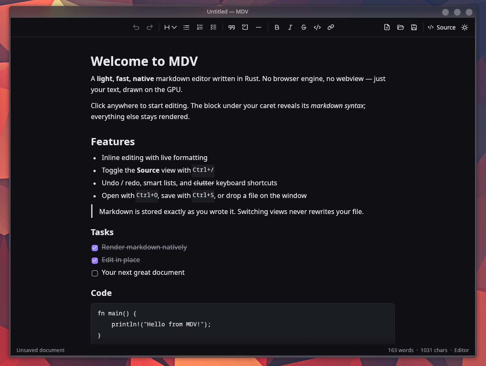
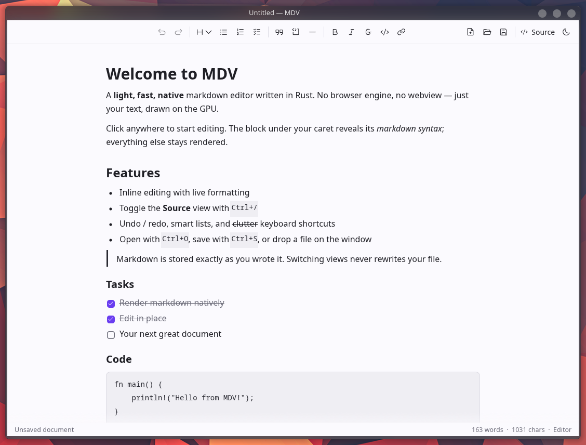

<p align="center">
  
</p>

<h1 align="center">MDV</h1>

<p align="center">
  A light, fast, native markdown viewer and editor written in Rust.<br>
  No webview, no browser engine: just your text, drawn on the GPU.
</p>

<p align="center">
  <a href="https://github.com/makzumi/MDV/releases/latest"></a>
  <a href="https://github.com/makzumi/MDV/actions/workflows/ci.yml"></a>
</p>

<p align="center">
  
  
</p>

## Features

- **Edit in place.** Everything stays rendered; the block under your caret reveals its markdown syntax, dimmed, so you can edit it (like Typora or Obsidian's live preview).
- **Source view.** One click (or `Ctrl+/`) shows the raw markdown, syntax-highlighted. The caret stays where it was.
- **Your file stays yours.** MDV only stores the markdown text, so it never reformats or rewrites what you wrote.
- **Smart editing.** Lists and task lists continue on Enter, checkboxes toggle with a click, and there are toolbar buttons and shortcuts for all common formatting.
- **Images.** Local files (relative to the document) and web images, including PNG, JPEG, GIF, WebP and SVG. Insert one from the toolbar (paste a link or browse), or drop an image file onto the window. Click an image to select it, then drag a corner handle to resize it.
- **Find and replace.** `Ctrl+F` / `Ctrl+H`, with match-case, replace one or replace all. Matches are highlighted in both views.
- **Light.** Built with [egui](https://github.com/emilk/egui) on OpenGL. It only redraws when you do something, so it uses 0% CPU when idle. The binary is about 14 MB.
- **Native feel.** Uses your desktop's fonts and native file dialogs, with dark and light themes.

Linux first (Wayland and X11). Windows and macOS builds are produced too; there, MDV uses its built-in font instead of the system one (font discovery uses `fc-match`, see `src/fonts.rs`).

## Download

Grab the latest build from the [Releases page](https://github.com/makzumi/MDV/releases/latest):

| Platform | File |
|---|---|
| Linux | `MDV-<version>-x86_64.AppImage`: `chmod +x` it and run |
| Windows | `MDV-<version>-windows-x86_64.exe`: portable, no installer |
| macOS | `MDV-<version>-macos-universal.dmg`: Apple Silicon and Intel |

Builds are **not code-signed**, so on first launch:
- **macOS:** right-click the app → Open (or run `xattr -dr com.apple.quarantine /Applications/MDV.app`).
- **Windows:** SmartScreen → "More info" → "Run anyway".

## Build from source

Requires Rust 1.95+.

```sh
git clone https://github.com/makzumi/MDV.git
cd MDV
cargo run --release -- path/to/file.md
```

### Install on Linux (from source)

```sh
./packaging/linux/install.sh              # binary, desktop entry, icons → ~/.local
./packaging/linux/install.sh --uninstall
```

This adds MDV to your app launcher and to "Open with" for `.md` files. It is also what gives the window its icon on **Wayland**: the compositor finds the icon through the installed `mdv.desktop` file (it matches the window's app id `mdv`). Without it, you get the generic Wayland icon. AppImage users get the same effect by integrating the AppImage (for example with Gear Lever or AppImageLauncher).

## Making a release (maintainers)

Pushing a version tag builds everything on GitHub Actions ([.github/workflows/release.yml](.github/workflows/release.yml)) and creates a **draft** release you review and publish:

```sh
# 1. bump `version` in Cargo.toml, commit
git tag v0.1.0
git push origin v0.1.0
```

| Platform | Artifact | Built on |
|---|---|---|
| Linux | `MDV-<v>-x86_64.AppImage` | Ubuntu 22.04 (runs on glibc 2.35+ distros) |
| Windows | `MDV-<v>-windows-x86_64.exe` (portable, icon embedded) | windows-latest |
| macOS | `MDV-<v>-macos-universal.dmg` (Apple Silicon + Intel) | macos-14 |

Build the AppImage locally (downloads `appimagetool` into `dist/`):

```sh
./packaging/linux/build-appimage.sh
```

## Images

MDV renders both `` and HTML `` tags, so READMEs with centered headers and side-by-side screenshots look right.

Resizing writes the size into the file. Plain markdown has no syntax for image size, so a resized image is saved as an HTML tag that GitHub, VS Code and most other renderers display at the same size:

```html

```

Click an image to select it. Then drag a corner handle to resize it, press `Delete` to remove it, or double-click it to edit its markdown.

Web (`https://`) images are downloaded when the document opens, like in any markdown viewer.

## How it works

**The markdown text is the only stored copy of the document.** Nothing is converted into a rich-text tree and back, so files are never rewritten behind your back, and switching between views loses nothing.

| File | Role |
|---|---|
| `src/doc.rs` | Text + selection (byte offsets) + undo/redo history + formatting commands (bold, headings, lists…) |
| `src/markdown.rs` | `pulldown-cmark` → top-level blocks with source offsets; style runs for syntax highlighting |
| `src/images.rs` | Parsing `` tags, resolving image paths, writing image markdown |
| `src/find.rs` | Find & replace (search, highlights, the find bar) |
| `src/editor.rs` | `LiveEditor` (rendered blocks + inline editing) and `SourceEditor` (full highlighted source) |
| `src/theme.rs` | Dark/light palettes, text formats |
| `src/fonts.rs` | Uses the desktop's sans/mono fonts via fontconfig; Phosphor icons |
| `src/app.rs` | Window, toolbar, shortcuts, open/save dialogs (XDG portal), unsaved-changes prompt |
| `packaging/` | AppImage build, Linux user install, macOS `Info.plist` |
| `.github/workflows/` | CI (lint + tests) and release builds |

**Editor view:** every block is drawn rendered. The block with the caret becomes an inline text editor that shows its markdown syntax dimmed (like Typora or Obsidian's live preview). Clicking rendered text maps the click back to the exact source position. Keys that cross block boundaries (Enter, Backspace/Delete at edges, arrows at the first/last line) are handled in `LiveEditor::handle_keys` before egui's TextEdit sees them.

**Source view:** the same `Doc`, shown as monospace highlighted text. The selection is shared, so the caret stays put when you switch.

## Shortcuts

| Keys | Action |
|---|---|
| `Ctrl+/` | Toggle editor ↔ source |
| `Ctrl+B` / `Ctrl+I` / `Ctrl+Shift+X` / `Ctrl+E` | Bold / italic / strikethrough / inline code |
| `Ctrl+K` | Link |
| `Ctrl+0…3` | Paragraph / heading level |
| `Ctrl+Z`, `Ctrl+Shift+Z` / `Ctrl+Y` | Undo, redo |
| `Ctrl+N` / `Ctrl+O` / `Ctrl+S` / `Ctrl+Shift+S` | New / open / save / save as |
| `Ctrl+F` / `Ctrl+H` | Find / find and replace |
| `Enter` / `Shift+Enter` (in find) or `F3` / `Shift+F3` | Next / previous match |
| `Ctrl+click` | Open a link |
| `Delete` (image selected) | Remove the image |
| `Esc` | Stop editing / deselect image / close find |

## Tests

```sh
cargo test
```

Includes headless UI tests (`egui_kittest`) that click and type into the live editor.

## Known limitations / next steps

- Selection can't span several blocks in the editor view (use the source view for that).
- Images inside a line of text (like badges) are shown after that line rather than inline.
- Pasting an image from the clipboard isn't supported yet; save it as a file and insert or drop it.
- Find matches the markdown source, so a search can't span formatting markers (`**bold**`).
- Theme follows the system at startup; the choice isn't persisted.

## License

[MIT](LICENSE)
